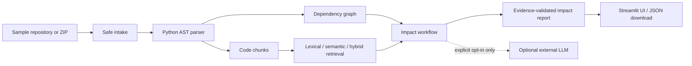

# ChangeRadar

**Local first code change impact analysis for Python repositories.** ChangeRadar
helps developers trace a proposed change to likely target symbols, statically
visible callers, source evidence, and focused regression test ideas.

It is a portfolio MVP: repository code is parsed but never executed, provider
access is off unless explicitly enabled, and deterministic analysis works
without API credentials.

## Try it locally

Python 3.10 or newer is required. From the repository root:

```bash
python3 -m venv .venv
source .venv/bin/activate
python -m pip install -e ".[dev,ui]"
streamlit run app.py
```

If the Streamlit file watcher reports optional `torchvision` import errors,
the checked-in configuration disables file watching. The interface should open
at the local URL printed by Streamlit.

### Quick walkthrough

1. Select **Included sample**.
2. Keep **Lexical (offline)** as the retrieval method.
3. Enter `Change validate_email_address to reject addresses without a domain after the @ symbol.`
4. Click **Analyze change**.
5. Review the direct target, retrieval-only context, suggested test idea, and
   cited source lines. Download the JSON report if useful.

The report labels deterministic output clearly. A retrieved match is shown as
context unless direct targeting or a statically supported dependency link
establishes an impact relationship. Retrieval scores are ranking signals, not
probabilities. Suggested tests are ideas; ChangeRadar does not create or run them.

## What it does

- Reads Python source from a bundled sample or a ZIP upload using bounded,
  path-checked intake. ZIP files are inspected in memory and never extracted.
- Parses symbols, source ranges, imports, and statically named calls with Python's
  AST. It never imports or executes analyzed repository code.
- Ranks code with lexical, optional local semantic, or hybrid retrieval.
- Builds an evidence-linked report with direct targets, dependency-linked
  candidates, retrieval-only context, uncertainties, and regression test ideas.
- Optionally calls an OpenAI-compatible chat-completions endpoint after both
  per-analysis consent and environment opt-in.

## Architecture



The main boundaries are small Python modules: intake, parsing, dependency
analysis, retrieval, report models, bounded tools, provider adapter, impact
workflow, and Streamlit presentation. The UI reuses the same analysis workflow
as the command-line demo and evaluation script.

## Retrieval

Lexical retrieval is the default and requires no model, API key, or network.
Semantic retrieval uses Sentence Transformers with
`all-MiniLM-L6-v2` on CPU. Hybrid retrieval combines lexical and semantic
signals and can include dependency relationships. If semantic dependencies or
model weights are unavailable, retrieval falls back to lexical ranking and
reports that fallback.

Install the optional semantic dependencies when you want to try those modes:

```bash
python -m pip install --index-url https://download.pytorch.org/whl/cpu torch
python -m pip install -e ".[semantic]"
python scripts/smoke_semantic.py
```

The first model use may download weights. Automated tests and the default
application flow do not download a model.

## Evaluation

The retrieval fixture has five labeled queries. It computes Recall@5 and mean
reciprocal rank (MRR) from actual ranked results for lexical, semantic, and
hybrid retrieval. The impact fixture has three labeled change cases and checks
direct-target and dependency-candidate precision/recall/F1, context false
impacts, evidence references, test-idea markers, and ambiguity disclosure.
These small fixture sets are useful regression checks, not general accuracy
claims.

Run offline evaluation without credentials or model downloads:

```bash
python scripts/evaluate_retrieval.py
python scripts/evaluate_impact.py
```

After installing and caching the semantic model, evaluate that path with:

```bash
python scripts/evaluate_retrieval.py --semantic
python scripts/evaluate_impact.py --method hybrid
```

## Optional external LLM

No provider is selected by default. To use an OpenAI-compatible endpoint,
configure credentials in your shell and explicitly opt in in the UI (or pass
`--allow-external` to the demo script):

```bash
export CHANGERADAR_ALLOW_EXTERNAL_CODE=true
export CHANGERADAR_LLM_ENDPOINT="https://your-provider.example/v1/chat/completions"
export CHANGERADAR_LLM_MODEL="your-model-name"
export CHANGERADAR_API_KEY="your-api-key"
```

External analysis can send the proposed change and bounded, redacted evidence
snippets. Review that content before enabling transmission. A ChatGPT
subscription does not itself provide API credentials or credits. Provider
failures return a labeled deterministic report. Live provider behavior has not
been verified.

## Safety and privacy

- Repository code is treated as untrusted data and is never executed.
- Uploads are limited to 30 MB, 1,000 source files, 1 MB per file, and 20 MB
  of total source. Only supported Python source is analyzed; virtual
  environments, generated files, and dependency directories are skipped.
- Repository source stays local unless the user explicitly enables a configured
  external provider. Model downloads contain model files, not repository code.
- API keys and local environment files should remain in environment variables
  or ignored local files, never in commits.

Secret redaction covers common key, token, password, bearer, and private-key
patterns. It is best effort and cannot detect every secret in source. Inspect
evidence before opting into external transmission.

## Development

Install the development tools, set up hooks, and run the checks:

```bash
python -m pip install -e ".[dev,ui]"
pre-commit install
pre-commit run --all-files
ruff check .
ruff format --check .
python -m pytest
git diff --check
```

Tests use fake providers and local fixtures. They do not call an external LLM
or download embedding models. The Streamlit integration test runs when the UI
extra is installed.

For a deterministic command-line demonstration:

```bash
python scripts/demo_impact.py tests/fixtures/retrieval_repo \
  "Change validate_email_address to reject addresses without a domain after the @ symbol."
```

## Limitations and next steps

Static analysis can miss dynamic dispatch, reflection, generated code, and
dependencies outside the scanned Python files. Retrieval and impact evaluations
use small hand-labeled fixtures. Test ideas are not implemented or executed,
and LLM integration has not been tested against a live service.

### Streamlit Community Cloud

The root `requirements.txt` installs the project and pins the tested Streamlit
version. The default deployment uses lexical retrieval and needs no model
download, LLM credential, or secret. To deploy, push this project to GitHub,
open Streamlit Community Cloud, connect the GitHub repository, and select
`main` with `app.py` as the entry point. Choose Python 3.12 in Advanced
settings, or another supported version that you have tested. Private
repositories require granting Community Cloud access to the repository.

Before sharing a public instance, decide how to handle anonymous ZIP uploads,
usage limits, retention, and external provider consent. Do not add provider
credentials unless you intend to enable external analysis. The local app and
test suite do not verify a live Community Cloud deployment.
